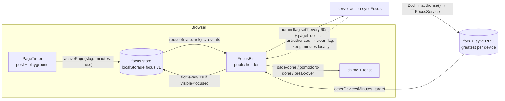
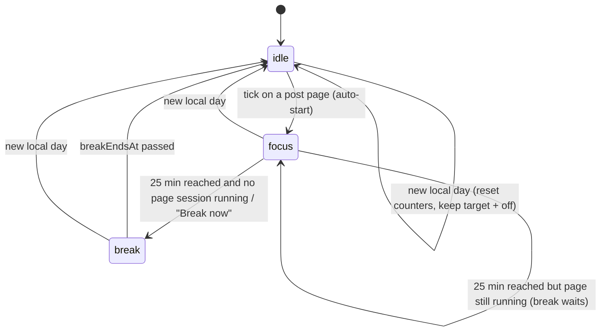

# Focus Timer (pomodoro + page sessions): Technical Spec

Status: Draft v1 · 2026-10-28 · Owner: admin (solo project) · Interview turns: 7 · Clarity at handoff: 5/5

## 0. Locked Requirements

| Dimension          | Decision                                                                                                                                                    | Source            |
| ------------------ | ----------------------------------------------------------------------------------------------------------------------------------------------------------- | ----------------- |
| The Ask: goal      | Help readers (and the admin) build a daily study habit with short sessions they can finish. The admin writes 10–12 min pages first, then makes them longer. | chosen            |
| The Ask: users     | Anonymous readers (browser only) and the admin (same timer, progress synced across devices)                                                                 | chosen            |
| The Ask: scope     | Every `/blog/[slug]` page (and its `/playground`). The target bar shows on every public page.                                                               | chosen            |
| The Ask: success   | The acceptance checks in §6.4 pass as unit tests                                                                                                            | default           |
| Global timer       | Classic pomodoro: 25 min focus, 5 min break. Auto-starts on post activity (first post open, and again after a break).                                       | chosen / inferred |
| Page timer         | Auto-starts on a post. Length = `notes.session_minutes` (admin sets it, ≥ 5; covers reading + playground + exercises).                                      | chosen            |
| Old notes          | No `session_minutes` → reading time (words / 200, rounded up), minimum 5                                                                                    | default           |
| Daily target       | Focus **minutes**. Presets 25 / 50 / 75 / 100, default 25.                                                                                                  | chosen / default  |
| Counting           | A minute counts **once** if any timer runs, and only in the **focused, visible** tab                                                                        | default           |
| Overlap with break | When the pomodoro ends mid-page, the break waits until the page is done (or "Break now" is tapped)                                                          | default           |
| Leave a page       | It pauses. Progress per post is kept for today only, then resumes.                                                                                          | default           |
| Playground         | Shares the post's page timer (keyed by slug)                                                                                                                | default           |
| Finish             | A chime (Web Audio) + toast card. Page done → "Next: <title>"; pomodoro done → break.                                                                       | default           |
| Next page          | Next published post in the same topic by `published_at`, oldest first; the last one → "Topic complete"                                                      | default           |
| Day reset          | The user's local midnight                                                                                                                                   | default           |
| Opt out            | A "Focus timer off" switch, remembered in the browser                                                                                                       | default           |
| Reader storage     | `localStorage` only; readers never call the server                                                                                                          | default           |
| Admin sync         | `focus_days(day, device_id, minutes)`; each device sends its own daily total, the server keeps the max; target in `planner_settings`                        | default           |
| Sync gating        | Only browsers that opened `/admin` sync (localStorage flag)                                                                                                 | default           |
| Offline            | Unsent minutes stay in the browser; the next sync sends the full day total                                                                                  | default           |
| Rollout            | Ships on for everyone. No flag. Rollback = revert + redeploy.                                                                                               | default           |
| LLM                | None                                                                                                                                                        | inferred          |

## 1. TL;DR & Workflow Topology

**Problem & success:** readers need small, finishable daily wins to build a study habit. Success = the acceptance checks in §6.4 pass, starting with the example day.

**TL;DR:** A client-only focus engine runs in the browser. Its state lives in `localStorage` and is driven by a pure reducer in `src/domain/focus/`. A `FocusBar` in the public header shows "X / target min" and runs the global 25/5 pomodoro. A `PageTimer` on each post (and its playground) runs that page's session. Every second, the focused, visible tab adds the elapsed time **once** if any timer is running. Pages stay static. Only the admin's browser calls one server action, which upserts a per-device day total and keeps the max, so retries and multiple devices never double count.

**Non-goals (v1):** reader stats or analytics · browser notifications · long breaks after 4 pomodoros · reader levels or adaptive lengths · a feature flag · a timer on list or topic pages (they show the bar only).

**Pomodoro state machine** (in the browser, not the DB):

## 2. Supabase Schema & State Contract

Only the admin's progress touches the DB. Readers never call the server.

### 2.1 Migration

Built: [`supabase/migrations/20261028120000_focus_timer.sql`](../../supabase/migrations/20261028120000_focus_timer.sql). It adds `notes.session_minutes` (5–240, nullable), `planner_settings.focus_target_minutes` (25/50/75/100), the `focus_days(day, device_id, minutes)` table (admin-only RLS), and the `focus_sync` RPC (keeps the max per device, returns the other devices' minutes and the target; `anon` is refused). Types are regenerated in `database.types.ts`.

### 2.2 State contract

**DB (admin only):**

| Write         | By                        | Guard                                  | Effect                                    |
| ------------- | ------------------------- | -------------------------------------- | ----------------------------------------- |
| `focus_sync`  | `syncFocus` server action | Zod + `authorize()` + RLS `is_admin()` | `minutes = greatest(old, new)` per device |
| target change | same call, `p_target` set | Zod enum 25/50/75/100 + DB `check`     | last write wins (it's a setting)          |

**Browser (`localStorage["focus:v1"]`):** the state schema, the `tick` reducer and its rules live in [`src/domain/focus/focus-timer.ts`](../../src/domain/focus/focus-timer.ts) (pure, no DOM). Key rules:

- Each tick's time belongs to the phase it was **spent in** (a break's last second never counts as focus).
- A moment counts once if the pomodoro is in `focus` or the page session is running; only active (visible + focused) ticks count; an inactive tick clears `lastTickAt`, so time away never counts; gaps are capped at `MAX_TICK_MS`.
- A full pomodoro breaks once no page session is still running (the "break waits for the page" rule is derived, not stored).
- A new local day resets everything except `target` and `off`. Saved state that fails Zod starts fresh.
- Admin-only fields (`deviceId`, other devices' minutes) arrive with T8.

**Session length:** [`src/domain/note/session.ts`](../../src/domain/note/session.ts): the admin's minutes, else words / 200 rounded up, never under 5.

### 2.3 Keys & connections

| Component                  | Client                                     | Key                         |
| -------------------------- | ------------------------------------------ | --------------------------- |
| Post / playground (static) | `container.public.*` (cookie-less)         | anon, published notes only  |
| `syncFocus` action         | `container.admin.focus()` (cookie session) | admin JWT, RLS `is_admin()` |
| Readers                    | none                                       | none                        |

Load: one admin, at most one request per 60 s per open device. No connection-budget concern.

## 3. LiteLLM & Agent Configuration

Not applicable: no LLM calls. (This repo uses Mastra/LangChain, not LiteLLM, anyway.)

## 4. Error Handling & Observability

### 4.1 Error taxonomy

| Class                  | Example                                      | Handling                                                                                                  |
| ---------------------- | -------------------------------------------- | --------------------------------------------------------------------------------------------------------- |
| Corrupt local state    | Old or edited `focus:v1` JSON                | Zod fails → `freshState(today)`. Today's progress is lost on that device (rare).                          |
| `localStorage` blocked | Private mode, storage full, `setItem` throws | try/catch. Run in memory for this page view; no crash.                                                    |
| Sync unauthorized      | Admin session expired                        | Action returns `unauthorized` → clear the sync flag; minutes stay local; visiting `/admin` re-enables it. |
| Sync network/DB error  | Offline, Supabase blip                       | Ignore; the next 60 s sync sends the full day total (idempotent).                                         |
| Invalid sync input     | Bad date, minutes > 1440                     | Zod → `validation` error; not retried.                                                                    |
| Audio blocked          | Autoplay policy before any user gesture      | Swallow the `AudioContext` error; the toast still shows.                                                  |

### 4.2 Retry budget

No retry loop. Sync is a full-state "set to max," so the 60 s interval _is_ the retry. Worst case: 1 call per minute per open admin device.

### 4.3 Timing

Tick every 1 s (`setInterval`) in each tab; only the active tab counts. `MAX_TICK_MS = 5 s` drops sleep and suspend gaps. The break uses an absolute `breakEndsAt`, so it survives reloads and hidden tabs.

### 4.4 Idempotency & concurrency

- **Server:** `greatest()` per `(day, device_id)` makes retries and reordering harmless. The sum over the other devices is computed server-side.
- **Two tabs:** only the tab with `visibilityState === "visible" && document.hasFocus()` ticks and writes. Other tabs reload state on the `storage` event. Write-after-read happens in the same tick, so the window for lost updates is under 1 s, and only when focus switches between tabs.
- **Day key:** the browser's local date. The server checks it is within ±1 day of the server's UTC date (covers every timezone) and rejects anything else.

### 4.5 Observability

No analytics (out of scope). The server action logs only failures (`console.error` with the error code, like the other actions).

## 5. Step-by-Step Implementation Tasks

**T1. Migration + types** · M0 · S · Depends: — · Delegatable ✓
Do: add §2.1 as a migration; `supabase db reset`; regenerate `database.types.ts`.
Done when: `pnpm test:db` passes; `focus_sync` called twice with 30 then 20 leaves 30.

**T2. `sessionMinutes` + note field** · M1 · M · Depends: T1
Do: `Note.sessionMinutes: number | null`; `NewNote`/`NotePatch`; `noteInputSchema.sessionMinutes` (`z.coerce.number().int().min(5).max(240)`, empty → null); mapper + `SupabaseNoteRepository`; in-memory fake; a number input in `note-editor.tsx` ("Session minutes, blank = reading time"); `src/domain/note/session.ts` with tests.
Done when: saving 12 shows 12 after reload; blank → null; 4 → validation error; `sessionMinutes` tests cover null → reading time, minimum 5, and the admin value winning.

**T3. Next post in topic** · M1 · S · Depends: —
Do: `NoteService.nextInTopic(note): Promise<Note | null>`: published, same `topicId`, `published_at` > this one, oldest first.
Done when: a service test with the in-memory fakes covers middle, last (null) and other-topic cases.

**T4. Focus reducer (the core)** · M1 · M · Depends: —
Do: `src/domain/focus/focus-state.ts` (schema, `freshState`) + `focus-timer.ts` (`tick`, `startBreakNow`, `setTarget`) per §2.2.
Done when: every acceptance check in §6.4 passes in `focus-timer.test.ts` with fixed timestamps.

**T5. Browser store** · M2 · S · Depends: T4
Do: `src/components/focus/focus-store.ts`: load/save `focus:v1` (try/catch + Zod), a `useSyncExternalStore` hook, the `storage` listener, and `isActive()` = visible && `document.hasFocus()`.
Done when: reload keeps state; a corrupt value resets without throwing.

**T6. `FocusBar` in the public header** · M2 · M · Depends: T5
Do: `src/components/focus/focus-bar.tsx` (client) in `src/app/(public)/layout.tsx` nav. Shows "X / 25 min" (+ `otherDevicesMinutes` for the admin), pomodoro state (focus mm:ss / break mm:ss / idle), a target preset menu, "Break now", and the "Focus timer off" toggle. Owns the 1 s interval and turns events into a chime (Web Audio oscillator, no asset) + `sonner` toast. Accessible: `role="timer"`, `aria-live="polite"` only on events (not every second), all controls keyboard-reachable.
Done when: checked in the browser preview at phone and desktop widths, light and dark.

**T7. `PageTimer` on post + playground** · M2 · S · Depends: T2, T3, T6
Do: `src/components/focus/page-timer.tsx` (client) receives `{slug, minutes, next: {title, href} | null}` from the server page; registers the active page with the store; shows a slim "7:00 left in this session" progress bar. Render it in `blog/[slug]/page.tsx` and `blog/[slug]/playground/page.tsx` with the **post's** slug. The "page-done" toast links to `next` or says "Topic complete".
Done when: post → playground keeps the remaining time; finishing shows the next-post toast.

**T8. Admin sync** · M3 · M · Depends: T1, T6
Do: domain `IFocusRepository.sync(...)` + `focusSyncSchema` (day within ±1 day, device uuid, minutes 0–1440, optional target); `FocusService.sync` (application); `SupabaseFocusRepository` calling `focus_sync`; `container.admin.focus()`; `src/app/actions/focus.ts` (`syncFocus`: Zod → `authorize()` → service); `src/components/focus/focus-sync-flag.tsx` mounted in `src/app/admin/layout.tsx` (sets `focus:sync=1` and creates `deviceId`). `FocusBar` syncs every 60 s and on `pagehide` when the flag is set; on `unauthorized` it clears the flag.
Done when: `FocusService` tests (fake repo) cover OK, unauthorized and invalid input; locally, laptop 28 + another browser 10 → both show 38.

**T9. Docs + checks** · M4 · S · Depends: all
Do: add `docs/features/F13-focus-timer.md` (rules + "Done when"), a row in `docs/00-overview.md`, a schema note in `docs/architecture/database.md`. Run `pnpm lint && pnpm typecheck && pnpm test` and `pnpm test:db`.
Done when: all green; the feature doc's "Done when" is ticked.

Parallel: T3 and T4 can start at once; T2 depends only on T1.

## 6. Rollout, Ownership & Config

### 6.1 Env vars & secrets

None new. Uses the existing Supabase URL, anon key and cookie session.

### 6.2 Environments & rollout

Local: `supabase start` + `pnpm dev`. Prod: deploy; the migration runs with the usual flow. Ships on for everyone. Readers can opt out with the "Focus timer off" switch. Kill switch = revert the commit and redeploy (pages are static, so this rebuilds them).

### 6.3 Ownership

The admin owns it. Runbook: clear a broken device → DevTools → delete `focus:v1`. Reset a synced day → `delete from focus_days where day = '<date>'`.

### 6.4 Acceptance checks (become `focus-timer.test.ts` + service tests)

Example day (lesson 1 = 12 min, lesson 2 = 15 min, target 25):

1. 9:00 Open lesson 1 → pomodoro `focus` and page timer start; total 0.
2. 9:05 Go to its playground (same slug) → page has 7:00 left.
3. 9:08–9:11 Tab hidden → nothing counts; the break clock (if any) still runs.
4. 9:15 Lesson 1 done (8 + 4 active min) → `page-done`; total 12 (both timers ran, counted once).
5. 9:15 Open lesson 2. 9:28 the pomodoro reaches 25 with the page at 13/15 → `pomodoro-done{breakDeferred:true}`, still counting.
6. 9:30 Lesson 2 done → `page-done`, then `break` until 9:35; total 27 / 25. A reload keeps `breakEndsAt`.
7. Local midnight → total 0, pages cleared, target and `off` kept.
8. Admin: device A 28 + device B 10 → each shows 38; a repeated sync of A=28 leaves 38; A sending 20 after 28 leaves 28.

Plus:

- Two "active" inputs in the same ms never count twice (only one tab ticks — a store test).
- A tick gap of 2 hours (laptop asleep) adds at most `MAX_TICK_MS`.
- `off = true` → nothing counts and nothing auto-starts.
- Corrupt `focus:v1` → fresh state.

## 7. Assumptions, Defaults & Open Risks

**Decided by default (worth a second look):**

- After a break, the next pomodoro auto-starts on post activity (inferred).
- Keep-the-max per device sync, replacing the earlier "increment-only" idea.
- Sync only in browsers that opened `/admin`.
- No long break after 4 pomodoros.
- Reading-time fallback at 200 words per minute.
- The admin target lives in `planner_settings` (last write wins across devices).
- Visible + focused counts; the bar is not counted on non-post pages unless the pomodoro is in `focus`.

**Placeholders:** `<ts>` in the migration file name only.

**Top risks:**

| Risk                                                                                                                                     | Likelihood | Impact                               | Mitigation                                                                                                                                                                                                                     |
| ---------------------------------------------------------------------------------------------------------------------------------------- | ---------- | ------------------------------------ | ------------------------------------------------------------------------------------------------------------------------------------------------------------------------------------------------------------------------------ |
| Watching the embedded YouTube video moves focus into the iframe; if `document.hasFocus()` turns false, the timer pauses during the video | medium     | high (videos are part of the lesson) | Checked in T6 with a same-origin iframe: `document.hasFocus()` stays true and ticks continue. Still to confirm with a real YouTube embed; if it pauses, treat `document.activeElement instanceof HTMLIFrameElement` as active. |
| Auto-start annoys casual readers (a chime 25 min later)                                                                                  | medium     | low                                  | The opt-out switch; no sound until the first user gesture (browser autoplay rules already enforce this).                                                                                                                       |
| Two tabs both briefly "focused" while switching → a lost or doubled second                                                               | low        | negligible                           | Only the focused tab writes; 1 s granularity.                                                                                                                                                                                  |
| The admin's clock or timezone is wrong → day keys are off                                                                                | low        | low                                  | ±1-day server check; the day row is per device anyway.                                                                                                                                                                         |
